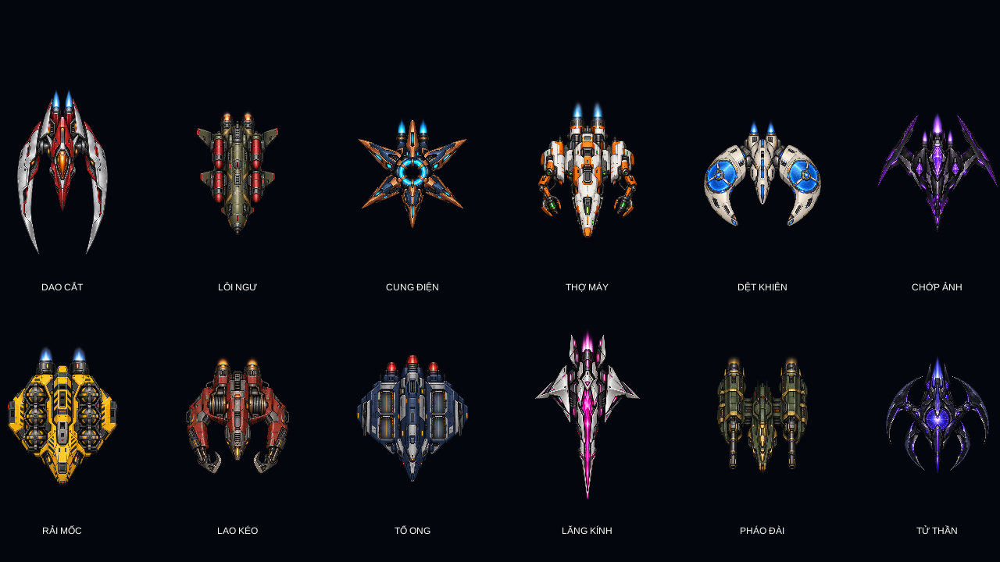
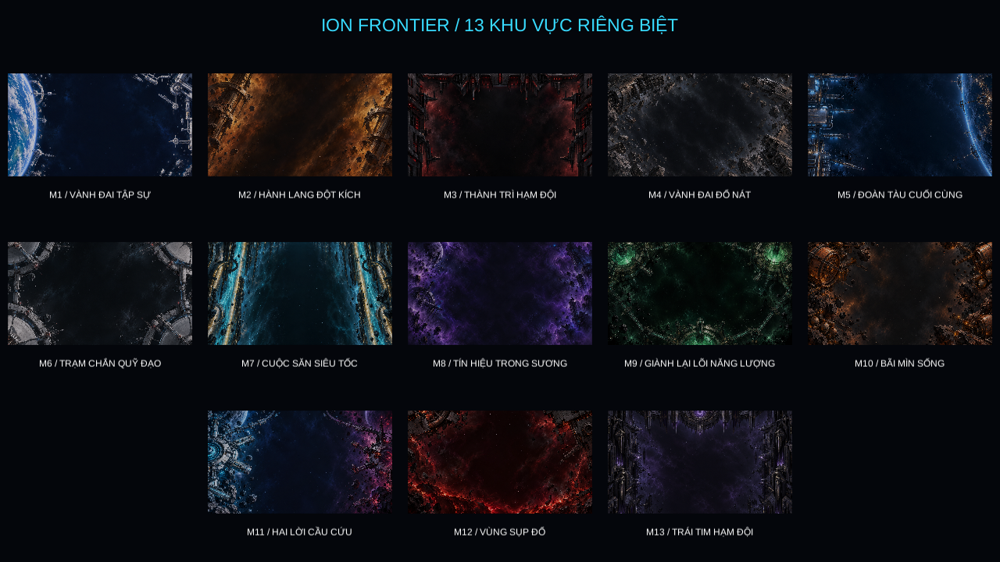

# ION FRONTIER — Hồ sơ đầy đủ về game

**Phiên bản được mô tả:** 0.11.1 trên máy, tại `D:\Projects\IonFrontier`.
**Ngày đối chiếu:** 21/10/2026.

Tài liệu này mô tả những gì đang được triển khai trong game: cách chơi, chiến dịch 13 màn, tám phi cơ, hệ súng, vật phẩm, địch, boss, môi trường và thành tích. Những đoạn ghi **Gợi ý chiến thuật** là cách chơi đề xuất từ các cơ chế đó, không phải điều kiện bắt buộc để qua màn.

Đây là hồ sơ của bản local đầy đủ. Repo GitHub đang được đồng bộ từng phần nên chưa chứa toàn bộ phiên bản này; xem `GITHUB-SYNC.md`.

## Mục lục

1. [Game là gì và mục tiêu của người chơi](#1-game-là-gì-và-mục-tiêu-của-người-chơi)
2. [Vòng chơi, điều khiển và giao diện](#2-vòng-chơi-điều-khiển-và-giao-diện)
3. [HP, sát thương và lướt né](#3-hp-sát-thương-và-lướt-né)
4. [Tám phi cơ người chơi](#4-tám-phi-cơ-người-chơi)
5. [Vũ khí và ghép nâng cấp](#5-vũ-khí-và-ghép-nâng-cấp)
6. [Đạn, vật phẩm và tiếp tế](#6-đạn-vật-phẩm-và-tiếp-tế)
7. [Hạm đội địch thường](#7-hạm-đội-địch-thường)
8. [Vật thể và tương tác nhiệm vụ](#8-vật-thể-và-tương-tác-nhiệm-vụ)
9. [Chi tiết từng màn](#9-chi-tiết-từng-màn)
10. [Boss, khiên và quá trình phá hủy](#10-boss-khiên-và-quá-trình-phá-hủy)
11. [Hệ năm sao, điểm số và mở khóa](#11-hệ-năm-sao-điểm-số-và-mở-khóa)
12. [Hình ảnh, hiệu ứng và âm thanh](#12-hình-ảnh-hiệu-ứng-và-âm-thanh)
13. [Lưu tiến trình và các bản chạy](#13-lưu-tiến-trình-và-các-bản-chạy)
14. [Cấu trúc project và kiểm tra](#14-cấu-trúc-project-và-kiểm-tra)
15. [Phạm vi hiện tại](#15-phạm-vi-hiện-tại)

## 1. Game là gì và mục tiêu của người chơi

ION FRONTIER là game bắn phi thuyền 2D theo chiều dọc, nhìn từ trên xuống. Người chơi điều khiển một phi cơ ở vùng chiến đấu phía dưới, bắn lên các đội tàu địch, tránh hỏa lực và thực hiện nhiệm vụ của từng khu vực.

Game phát triển từ ý tưởng arcade kiểu bắn gà sang bối cảnh chiến tranh không gian. Đối tượng chiến đấu hiện là tàu trinh sát, chiến đấu cơ, tàu hỗ trợ, chiến hạm và boss; không còn lấy gà hay trứng làm chủ đề gameplay.

Mục tiêu xuyên suốt là vượt 13 khu vực để đánh bại **Đế Hạm Hư Không**. Ba màn đầu dạy nền tảng chiến đấu; mười màn sau thay đổi nhiệm vụ giữa truy đuổi, hộ tống, công phá, cứu hộ, chiếm vùng, phá mìn và thoát khỏi không gian sụp đổ.

Game có ba lớp mục tiêu:

- **Qua màn:** thực hiện các điều kiện chính và hạ toàn bộ boss của màn.
- **Mở khóa:** nhận màn tiếp theo và phi cơ mới tại những mốc quy định.
- **Chinh phục thành tích:** chơi lại để đạt tối đa năm sao mỗi màn, tương đương 65 sao toàn chiến dịch.

Mỗi màn đều có trận boss cuối. Một số trận có nhiều boss cùng lúc. Chỉ khi boss cuối nổ xong game mới ghi nhận chiến thắng và lưu tiến trình.

## 2. Vòng chơi, điều khiển và giao diện

### 2.1. Một lượt chơi diễn ra thế nào?

1. Tại căn cứ, chọn màn đã mở và phi cơ đã sở hữu.
2. Xem nhiệm vụ và nút **Tiêu chí 5 sao** để biết yêu cầu thành tích.
3. Xuất kích với đầy HP, lượng đạn đầu màn và súng Ion cấp 1.
4. Chiến đấu qua các đợt hoặc ba chặng nhiệm vụ; nhặt tiếp tế, ghép kiểu bắn, chọn một trong ba thẻ tại hai checkpoint và kết hợp mô-đun trong lượt.
5. Đánh boss, xử lý khiên hoặc các mục tiêu phụ của trận boss.
6. Chờ chuỗi phá hủy boss hoàn tất.
7. Xem bảng kết quả: điểm, sao lượt này, thành tích tốt nhất, tiêu chí đạt/chưa đạt và phần mở khóa.
8. Chọn màn tiếp, đổi phi cơ hoặc chơi lại để săn sao.

Thua không xóa các màn, tàu và sao đã mở. Súng và nâng cấp trong lượt không được mang sang màn mới.

### 2.2. Điều khiển

| Thao tác | Điều khiển |
| --- | --- |
| Di chuyển | Chuột, WASD hoặc phím mũi tên |
| Bắn | Giữ Space hoặc chuột trái |
| Bật/tắt tự bắn | F; mặc định tắt khi bắt đầu màn |
| Lướt né | Shift trái/phải hoặc chuột phải |
| Đại chiêu của phi cơ | Q hoặc nút trên HUD |
| Tạm dừng/tiếp tục | P hoặc Esc |
| Bật/tắt âm thanh | M |
| Chọn phi cơ tại căn cứ | Phím 1–8 hoặc bấm thẻ tàu |
| Chọn màn | Bấm ô màn ở căn cứ |
| Chọn tuyến màn 11 | E hoặc R khi game yêu cầu, hoặc nút tuyến tương ứng |
| Chơi lại khi thua/hoàn tất chiến dịch | R; bảng kết quả cũng có nút chơi lại |

Khi dùng bàn phím, tàu di chuyển theo hướng nhấn. Khi chuyển sang chuột, tàu đuổi theo vị trí chuột trong giới hạn tốc độ của thân tàu; không dịch chuyển tức thời tới con trỏ. Cả hai cách lái đều chịu giới hạn vùng chơi.

### 2.3. Giao diện chiến đấu

| Vị trí | Thông tin |
| --- | --- |
| Trên giữa | Số màn, tên khu vực, trạng thái nhiệm vụ hoặc boss |
| Trên trái | Chặng hiện tại, mục tiêu chính, mục tiêu phụ và gợi ý |
| Trên phải | Mục tiêu vừa bị đánh: ảnh tàu, tên, HP hiện tại/tối đa và trạng thái |
| Thanh lớn phía trên | HP boss; riêng đoạn truy đuổi màn 4 dùng thanh tiến độ đường thoát |
| Dưới trái | Ảnh/tên phi cơ của mình và thanh HP chi tiết |
| Dưới giữa | Đạn, kiểu bắn đang ghép, sát thương mỗi viên, loạt/giây và số viên/loạt |
| Dưới phải | Đại chiêu, trạng thái nạp Q và hồi lướt |

Bảng mục tiêu ghi nhận cả tàu thường lẫn boss và giữ thông tin khoảng tám giây. Đánh trúng khiên vẫn hiện trạng thái bị chặn, không trừ HP giả. Khi đánh boss phụ, thanh boss lớn theo mục tiêu boss đó. Game không rải thanh HP lớn lên mọi địch thường.

### 2.4. Hướng dẫn mở đầu

Màn 1 có bốn thao tác tập làm quen: di chuyển, bắn hạ mục tiêu tập, lướt và nhặt hộp đạn. Trong thời gian tập không có hỏa lực địch đe dọa người chơi. Kết thúc hướng dẫn sẽ cấp lại đạn đầu màn và xóa điểm/địch tập trước khi bắt đầu các đợt thật.

Có nút bỏ qua hướng dẫn và nút học lại ở căn cứ.

## 3. HP, sát thương và lướt né

### 3.1. HP là số thực

Tàu người chơi có thanh HP, không dùng luật chịu một số phát cố định rồi chết. Một viên đạn nhẹ, một ngư lôi và đứng trong laser gây thiệt hại khác nhau. Các mức HP tối đa phụ thuộc phi cơ đang chọn.

| Nguồn gây sát thương | Mức hiện tại |
| --- | ---: |
| Đạn thường theo cỡ đạn | 10, 14, 18 hoặc 24 HP |
| Đạn cơ bản tại màn 1–2 | Bằng 80% các mức trên |
| Pháo truy kích màn 4 | 10 HP ở hai chặng đầu; 12 HP ở chặng cuối |
| Ngư lôi Lôi Ngư | 24 HP |
| Va tàu thường | 20 HP |
| Va boss | 32 HP |
| Va thiên thạch | 18 HP |
| Va mìn | 26 HP |
| Laser | 40 HP/giây khi đứng trong tia |
| Vùng đỏ sụp đổ | 22 HP/giây khi ở trong vùng nguy hiểm |

Sau một đòn rời rạc, tàu có khoảng 0,55 giây miễn sát thương. Laser và vùng sụp đổ trừ HP theo thời gian, không tự tạo khoảng miễn sát thương đó ở mỗi nhịp. Lướt và đại chiêu vẫn có thể bảo vệ tàu trong thời gian tác dụng.

### 3.2. Lướt

- Thời gian lao nhanh: khoảng 0,16 giây.
- Hồi chiêu: 2,4 giây.
- Bảo vệ khi kích hoạt: khoảng 0,38 giây.
- Tốc độ lướt: 27 đơn vị thế giới/giây nhân với hệ số tốc độ riêng của phi cơ.
- Lướt theo hướng đang lái; nếu đứng yên thì lướt lên phía trước.

**Gợi ý chiến thuật:** dùng lướt để đi qua một khe đạn hoặc rời đường ngắm đã khóa. Việc lướt liên tục không thay thế quan sát, vì có thời gian hồi và thời gian bảo vệ ngắn.

### 3.3. Hồi máu và tổng thiệt hại

Quà sửa tàu hồi 30 HP, không vượt HP tối đa. Đại chiêu Thiết Vệ hồi 20 HP. Trước boss của màn 4–13, game hồi thêm 20 HP.

Game đồng thời ghi nhận **tổng HP thực sự đã mất trong cả màn** để chấm sao. Hồi đầy lại không xóa tổng này. Vì vậy người chơi có thể đạt sao giữ HP cuối trận nhưng mất sao né tránh nếu trước đó đã trúng nhiều đòn.

## 4. Tám phi cơ người chơi

### 4.1. Bảng chỉ số và mở khóa

Tốc độ trong bảng là đơn vị thế giới/giây. Sát thương và nhịp bắn là hệ số nhân của súng thường; đại chiêu sử dụng cơ chế sát thương riêng.

| Phi cơ | HP | Tốc độ | Sát thương súng | Nhịp bắn | Mở khóa |
| --- | ---: | ---: | ---: | ---: | --- |
| Phong Ưng | 100 | 10,50 | ×1,00 | ×1,00 | Có từ đầu |
| Lôi Điểu | 90 | 11,97 | ×0,92 | ×1,12 | Thắng màn 1 |
| Thiết Vệ | 130 | 9,24 | ×1,15 | ×0,90 | Thắng màn 2 |
| Hỏa Phượng | 110 | 10,08 | ×1,12 | ×0,96 | Thắng màn 5 |
| Ảnh Vũ | 95 | 11,55 | ×0,90 | ×1,16 | Thắng màn 7 |
| Từ Long | 120 | 9,87 | ×1,05 | ×0,96 | Thắng màn 9 |
| Tinh Vân | 100 | 11,03 | ×0,98 | ×1,08 | Thắng màn 11 |
| Hư Không | 85 | 12,18 | ×1,10 | ×0,92 | Thắng màn 13 |

Các tàu dùng chung hệ đạn, quà và ghép súng. Khác biệt gồm dáng tàu, màu hiệu ứng, HP, tốc độ, sát thương, nhịp bắn và Q. Mở khóa phi cơ không đồng nghĩa bắt buộc dùng phi cơ mới; có thể quay lại chọn bất kỳ tàu đã mở ở căn cứ.

### 4.2. Phong Ưng — cân bằng

**Nhận dạng:** thân bạc/trắng, buồng lái và động cơ xanh lam; dáng nhọn, cánh vuốt.

Phi cơ tiêu chuẩn, thích hợp học nhịp di chuyển, bắn và quản lý đạn. Không thiên quá mạnh về HP hay tốc độ.

**Q — Pháo Thiên Quang:** nạp khoảng 0,4 giây, sau đó phát tia xuyên trong 1,2 giây. Hệ thống chọn boss hoặc địch gần và theo mục tiêu khi nó còn sống. Mục tiêu nằm trong tia suốt thời gian khai hỏa có thể nhận tổng 90 sát thương, nếu không bị khiên chặn. Tia cũng xóa đạn địch chạm vào đường bắn.

**Gợi ý chiến thuật:** dùng khi lõi boss đã mở, giữ vị trí cho tia bám mục tiêu trong phần lớn thời gian bắn.

### 4.3. Lôi Điểu — trinh sát cơ động

**Nhận dạng:** bạc và vàng, cánh rộng, hai cụm pháo rõ ràng.

Nhanh và bắn dày hơn Phong Ưng, đổi lại HP và sát thương mỗi viên thấp hơn.

**Q — Lôi Liên Hoàn:** ba đợt sét. Mỗi đợt nối qua tối đa tám mục tiêu, gây 30 sát thương trên mỗi mục tiêu được đánh. Một đợt không lặp lại cùng một tàu; các đợt sau có thể tiếp tục đánh tàu còn sống. Một boss chịu đủ ba đợt có thể nhận 90 sát thương trước các cơ chế chặn.

**Gợi ý chiến thuật:** có lợi khi cần dọn đội hình đông, mục tiêu ưu tiên hoặc nhiều tàu boss đang mở lõi.

### 4.4. Thiết Vệ — thiết giáp hạng nặng

**Nhận dạng:** bạc và xanh lục, thân gọn nhưng nhiều tấm giáp.

Có HP cao nhất, sát thương mỗi viên cao; di chuyển và bắn chậm hơn. Đây là khác biệt chỉ số thực, không chỉ là ngoại hình.

**Q — Pháo Đài Xung:** bảo vệ bốn giây, hồi 20 HP và phát ba sóng xung kích. Mỗi sóng gây 30 sát thương cho địch trong bán kính 13 đơn vị, đồng thời quét đạn và laser.

**Gợi ý chiến thuật:** phù hợp các đoạn giữ vùng, cứu hộ hoặc thời điểm chiến trường quá dày đạn.

### 4.5. Hỏa Phượng — hỏa lực đột kích

**Nhận dạng:** đỏ/cam, thân rộng với các khoang bom nhiệt.

HP khá và sát thương súng cao, tốc độ/nhịp bắn hơi thấp hơn chuẩn.

**Q — Mưa Nhiệt Hạch:** rải sáu bom theo nhịp vào vị trí mục tiêu. Mỗi vụ nổ có sát thương vùng và để lại vùng cháy; toàn hiệu ứng kéo dài khoảng ba giây. Bom có thể tác động cả địch và vật thể phá hủy trong vùng. Vị trí bom đã rơi giữ nguyên trên sân, không đuổi theo mục tiêu.

**Gợi ý chiến thuật:** hiệu quả hơn khi mục tiêu chậm, đứng gần nhau hoặc còn lưu lại trong vùng cháy.

### 4.6. Ảnh Vũ — liên thanh linh hoạt

**Nhận dạng:** tím, thân chẻ và cánh giống hai lưỡi dao.

Di chuyển nhanh, nhịp bắn cao nhất trong tám tàu, HP và sát thương mỗi viên thấp hơn chuẩn.

**Q — Ảnh Song Hành:** tạo hai phân thân ở hai bên tàu trong bốn giây. Phân thân tự ngắm và bắn đạn thật theo nhịp khoảng 0,22 giây; các phát này không trừ đạn kho. Mỗi viên phân thân có mức sát thương riêng 2,5.

**Gợi ý chiến thuật:** dùng khi vừa phải di chuyển làm nhiệm vụ vừa cần duy trì hỏa lực lên địch.

### 4.7. Từ Long — hộ vệ bền bỉ

**Nhận dạng:** xanh ngọc, dáng móng ngựa với các cuộn từ hai bên.

HP cao, sát thương hơi nhỉnh hơn chuẩn, cơ động và tốc bắn hơi thấp hơn.

**Q — Xoáy Từ Phản Kích:** sau khi kích hoạt, hút đạn địch mới đi vào vùng quanh tàu trong khoảng 1,6 giây rồi bắn 12 viên phản kích. Đạn phản kích có tự tìm mục tiêu và xuyên hai mục tiêu. Hút nhiều làm tăng sát thương: mức cơ sở tám mỗi viên, tăng theo số viên hấp thụ và có giới hạn.

**Gợi ý chiến thuật:** đạn dày trong giai đoạn hút có thể chuyển thành một loạt phản công mạnh. Việc hấp thụ phụ thuộc đạn thực sự xuất hiện và đi vào vùng trong thời gian chiêu hoạt động.

### 4.8. Tinh Vân — yểm trợ chính xác

**Nhận dạng:** xanh lam đậm/xanh tím, cấu trúc giống phi cơ dẫn đội.

HP chuẩn, tốc độ và nhịp bắn tốt; sát thương mỗi viên gần mức chuẩn.

**Q — Phi Đội Tinh Vân:** gọi ba tàu yểm trợ trong bốn giây. Mỗi tàu tự chọn mục tiêu và oanh kích bằng tia theo nhịp khoảng 0,45 giây; mỗi lần đánh gây bốn sát thương. Hỏa lực yểm trợ không tốn đạn kho.

**Gợi ý chiến thuật:** có ích khi mục tiêu phân tán, người chơi đang bận giữ vị trí hoặc né đạn.

### 4.9. Hư Không — đánh nhanh rút gọn

**Nhận dạng:** tím/hồng, thân tối với vùng năng lượng nổi bật.

Di chuyển nhanh nhất và sát thương súng cao, nhưng HP thấp nhất. Mở sau màn 13 để chơi lại các màn bằng một cách điều khiển khác.

**Q — Bẻ Cong Không Gian:** đặt vùng ảnh hưởng tại vị trí kích hoạt, bán kính bảy đơn vị. Trong ba giây, địch và đạn địch trong vùng chậm còn khoảng 32% tốc độ. Sau đó vùng nổ gây 90 sát thương theo diện tích. Tâm vùng giữ tại vị trí ban đầu, không bay theo người chơi.

**Gợi ý chiến thuật:** đặt vùng ở nơi địch/boss sẽ đi qua rồi di chuyển ra vị trí thuận lợi để tận dụng thời gian làm chậm.

### 4.10. Quy tắc chung của Q

- Cần một lõi đại chiêu; trữ tối đa một lần.
- Không tốn đạn súng.
- Không thể kích hoạt chồng khi Q trước đang chạy.
- Mọi tàu đều quét đạn địch/laser đang có tại thời điểm kích hoạt và nhận bảo vệ ban đầu; Thiết Vệ có thời gian bảo vệ dài hơn.
- Trong các màn mở rộng, kích hoạt Q còn gây xung phá vật thể nhiệm vụ có thể phá hủy.
- Khiên boss và khóa chuyển pha vẫn được tôn trọng; Q không mặc nhiên xuyên các cổng miễn sát thương.
- Tạm dừng đóng băng chiêu; chơi lại/về căn cứ dọn hiệu ứng.
- Bản chơi thường khởi đầu màn với Q bằng 0. Bản mở đầy đủ cấp một Q khi vào màn. Màn 4–13 cấp một Q khi chuyển sang boss.

## 5. Vũ khí và ghép nâng cấp

### 5.1. Bốn kiểu súng

| Kiểu | Cấp 1 | Cấp 2 | Cấp 3 | Đặc tính |
| --- | --- | --- | --- | --- |
| Ion kép | 2 viên | 3 viên | 4 viên | Bắn thẳng; nền ban đầu |
| Tỏa | 3 viên | 5 viên | 7 viên | Mở rộng góc bắn |
| Xuyên | 1 viên, sát thương nền 1 | 1 viên, sát thương nền 2 | 2 viên, sát thương nền 3 | Xuyên tối đa ba mục tiêu/vật thể |
| Truy đuổi | 2 viên, sát thương nền 1 | 2 viên, sát thương nền 2 | 3 viên, sát thương nền 2 | Tự chỉnh hướng tìm địch |

Các con số là cấu hình nền trước hệ số phi cơ và nâng cấp chỉ số. Một loạt chỉ tốn **một đơn vị đạn kho**, kể cả khi trong loạt có nhiều viên.

### 5.2. Ghép tối đa hai kiểu đặc biệt

Ion là kiểu khởi đầu. Ba kiểu đặc biệt Tỏa, Xuyên và Truy đuổi sử dụng tối đa hai ô ghép.

| Tổ hợp | Kết quả |
| --- | --- |
| Tỏa + Xuyên | Cả loạt tỏa có khả năng xuyên |
| Tỏa + Truy đuổi | Các viên tỏa tự điều chỉnh hướng tìm địch |
| Xuyên + Truy đuổi | Đạn tự tìm mục tiêu, xuyên rồi có thể hướng tới mục tiêu tiếp |

Nhặt lại kiểu đã có tăng cấp riêng kiểu đó, tối đa cấp 3. Nhặt kiểu thứ ba khác hai kiểu đang dùng thay kiểu được trang bị lâu nhất. Cấp đã tăng của một kiểu được giữ trong cùng lượt, kể cả khi kiểu đó rời rồi trở lại ô ghép.

Quà **Cấp kiểu bắn +1** tăng cả hai kiểu đang trang bị; nếu chưa có kiểu đặc biệt thì nâng Ion.

Hệ thống lấy số viên và sát thương nền cao nhất trong các kiểu đang ghép, rồi áp dụng thuộc tính tỏa/xuyên/tìm mục tiêu. Nhịp cơ sở dùng khoảng nghỉ dài nhất của các kiểu: Ion 0,17 giây; Tỏa/Xuyên 0,24 giây; Truy đuổi 0,30 giây. Do đó thêm kiểu đặc biệt không chỉ đổi màu đạn.

### 5.3. Ba nâng cấp chỉ số độc lập

| Nâng cấp | Mỗi lần nhặt | Tối đa | Hiệu quả khi đầy |
| --- | --- | ---: | --- |
| Sát thương | +20% mức cơ sở | 10 lần | ×3 sát thương cơ sở |
| Nhịp bắn | +10% mức cơ sở | 10 lần | ×2 số loạt/giây cơ sở |
| Đa đạn | Thêm một viên mỗi loạt | 8 lần | Thêm tám viên mỗi loạt |

Ba nhóm này không chiếm hai ô kiểu bắn và có thể cùng tồn tại với mọi tổ hợp.

Cách tính súng thường:

```text
Sát thương mỗi viên = sát thương nền của loadout × (1 + 0,2 × số cấp sát thương) × hệ số sát thương phi cơ
Loạt/giây = (1 / khoảng nghỉ cơ sở của loadout) × (1 + 0,1 × số cấp nhịp bắn) × hệ số nhịp phi cơ
Viên/loạt = số viên nền cao nhất của loadout + số cấp đa đạn
```

Ví dụ: Phong Ưng dùng Tỏa cấp 2 + Xuyên cấp 3, có ba nâng cấp sát thương và hai đa đạn: năm viên nền + hai = bảy viên/loạt; sát thương mỗi viên là 3 × 1,6 = 4,8 trước giáp/khiên của địch. Mỗi loạt vẫn tiêu hao một đạn kho.

Các chỉ số được đặt lại khi bắt đầu màn mới hoặc chơi lại, không phải nâng cấp vĩnh viễn cho tài khoản.

### 5.4. Lựa chọn chiến thuật0.11.0

Mỗi màn có hai lần chọn một trong ba thẻ nâng cấp. Màn1–3 chọn sau đợt1/2; màn4 chọn ở1.200/2.400m; màn5–13 chọn khi vào chặng2/3. Màn chọn đóng băng mô phỏng và đồng hồ chấm sao. Chọn bằng chuột hoặc1/2/3, sau đó trở lại trận. Các thẻ gồm phát triển súng, mô-đun phù hợp và hỗ trợ theo HP/đạn. Mô-đun có ô riêng với hai ô kiểu bắn; tối đa hai mô-đun/lượt, reset khi xuất kích lại.

| Mô-đun | Tác dụng |
| --- | --- |
| Nòng hội tụ | Góc Tỏa còn60%, sát thương đạn chính tăng15% |
| Đạn phân mảnh | Viên Xuyên giảm15% sát thương; hit thật đầu tiên của mỗi viên chính tạo hai mảnh30%, tối đa bốn mảnh/loạt |
| Sét dẫn hướng | Mỗi sáu loạt trúng, phóng sét sang một địch cách tối đa3đơn vị, gây50% sát thương viên kích hoạt |
| Động cơ phản kích | Sau lướt, ba loạt trong hai giây tăng25% sát thương |
| Buồng xung điện | Mỗi loạt thứ tám tăng35% sát thương và xuyên thêm một mục tiêu |
| Đạn dư chấn | Mỗi năm tàu thường do súng chính hạ tạo nổ bán kính1,6, gây75% sát thương viên kết liễu |
| Giáp phản ứng | Mất HP thật tạo xung xóa đạn gần; hồi tám giây |
| Nam châm tiếp tế | Phạm vi hút tăng60%, tốc độ hút tăng20%, không đổi tỷ lệ rơi |
| Bộ thu hồi đạn | Mỗi ba tàu thường do súng chính hạ hoàn ba đạn, tối đa30đạn/màn |

Đạn phụ, Q, drone và đồng minh không tự tạo chuỗi kích hoạt đệ quy. Mô-đun cần một kiểu bắn sẽ tạm ngừng nếu kiểu đó bị thay; nhặt lại kiểu sẽ hoạt động lại.

Sáu đội hình phối hợp thay một phần lượt spawn cũ: khiên+xạ thủ, kéo+laser, tàu mẹ+đội sửa, gọng kìm, tàu báo động và mìn+ngư lôi. Hạ nguồn hỗ trợ sẽ cắt đúng tác dụng; đội hình có cảnh báo và giới hạn sinh viện binh. Màn4 dùng timeline truy đuổi riêng.

| Đội hình | Cách phối hợp và cách phá |
| --- | --- |
| Mũi khiên/xạ thủ | Tàu khiên liên kết với hai xạ thủ trong phạm vi gần, giảm35% sát thương đồng đội nhận. Phá tàu nguồn hoặc tách khỏi phạm vi để ngắt khiên. |
| Kéo/làn laser | Móc khóa vị trí, kéo theo nhịp rồi dừng kéo trước cảnh báo laser. Rời làn đã khóa bằng di chuyển thường; hạ móc để ngừng các chu kỳ kéo tiếp. |
| Tàu mẹ/xưởng sửa | Thợ máy hồi2HP cho tàu mẹ mỗi3giây; tàu mẹ sinh hai tàu con mỗi5giây, tối đa bốn con đang sống. Phá thợ máy cắt sửa, phá tàu mẹ ngừng sinh thêm; con còn sống tiếp tục giao tranh. |
| Hai cánh gọng kìm | Hai nhóm vào từ hai rìa, đánh chéo và đổi hướng lao, tạo áp lực hai phía. Phá một cánh để mở khoảng trống; địch ưu tiên màn7 vẫn phải bị hạ. |
| Báo động/hộ tống | Tàu tín hiệu phát viện binh một lần sau7,6giây. Hạ sớm nhận20đạn, hoặc300điểm nếu kho đầy. Tàu rút không phải mục tiêu bắt buộc. |
| Mìn/ngư lôi | Tàu rải ba mìn theo nhịp, tàu ngư lôi phóng đạn tăng tốc từ phía còn lại. Bắn mìn tạo phản ứng dây chuyền hoặc hạ nguồn hỏa lực gây nguy hiểm nhất. |

Director tính cả tàu ưu tiên và đội đang sống, giới hạn tối đa18tàu cho các lượt đội hình tùy chọn. Tàu sinh thêm phải chờ slot trống. Tàu bị tái dùng slot không thừa kế vai trò/liên kết của tàu cũ.


## 6. Đạn, vật phẩm và tiếp tế

### 6.1. Đạn đầu màn

| Màn | Đạn được cấp |
| --- | ---: |
| 1 | 180 |
| 2 | 210 |
| 3 | 240 |
| 4–13 | 300 |

Kho đạn tối đa 600. Khi bằng 0, súng không bắn được; di chuyển, né và các Q đã nạp vẫn là những phương án xử lý.

### 6.2. Mười loại quà

| Quà | Hình/màu nhận dạng | Tác dụng |
| --- | --- | --- |
| Đạn | Ba viên xanh ngọc | +60 đạn kho |
| Sửa tàu | Khiên/thập xanh lam | +30 HP; sửa thêm 15 HP cho vận tải nếu có |
| Cấp kiểu bắn | Hai mũi tên vàng | Nâng các kiểu đang dùng, tối đa cấp 3 |
| Tỏa | Ba nhánh xanh lục | Trang bị/nâng Tỏa, kèm +20 đạn |
| Xuyên | Mũi nhọn tím | Trang bị/nâng Xuyên, kèm +20 đạn |
| Truy đuổi | Tâm ngắm cam | Trang bị/nâng tự tìm mục tiêu, kèm +20 đạn |
| Đại chiêu | Ngôi sao đỏ | Nạp một lần Q, trữ tối đa một |
| Sát thương | Hai nét chéo đỏ/cam | +20% sát thương cơ sở |
| Nhịp bắn | Tia sét vàng nhạt | +10% nhịp bắn cơ sở |
| Đa đạn | Ba nút hồng tách nhánh | Thêm một viên/loạt |

Vật phẩm có tên hiện trên sân, trôi xuống và được hút khi tàu tới gần. Nếu không nhặt, chúng có thể rời sân hoặc hết thời gian tồn tại. Có thể xem bảng vật phẩm trong game.

Quà nâng chỉ số hoặc cấp kiểu bắn đã đầy được đổi thành 30 đạn. Nhặt lõi Q khi đã trữ một lần cũng cho 30 đạn thay vì trữ lần thứ hai. Nhặt quà sửa khi đầy HP có thêm điểm.

### 6.3. Tỷ lệ rơi

Mỗi tàu thường bị tiêu diệt có 15% cơ hội rơi một món. Khi đã rơi, loại vật phẩm được chọn theo trọng số; mười loại không có xác suất bằng nhau.

| Loại | Trọng số lựa chọn |
| --- | ---: |
| Đạn | 20 |
| Sửa tàu | 12 |
| Cấp kiểu bắn | 6 |
| Tỏa / Xuyên / Truy đuổi | 6 cho mỗi loại |
| Đại chiêu | 3 |
| Sát thương | 16 |
| Nhịp bắn | 14 |
| Đa đạn | 14 |

Đây là trọng số bên trong lượt rơi 15%, không phải tỷ lệ rơi trực tiếp của mỗi loại.

### 6.4. Tiếp tế có điều kiện

- **Màn 1–3:** dọn xong một đợt có một quà; nếu đạn thấp thì ưu tiên đạn, sau đó bổ sung kiểu bắn/chỉ số.
- **Màn 4:** hai checkpoint trên đường thoát có đạn và nâng cấp; không có đợt quà định kỳ 25/32 giây trong đoạn chạy.
- **Màn 5–13:** có tiếp tế ở giây 25 rồi mỗi 32 giây của đoạn nhiệm vụ trước boss, cùng tiếp tế chuyển chặng.
- **Chuyển chặng mở rộng:** thả một hộp đạn và một nâng cấp chỉ số; đồng thời dọn đạn địch đang có.
- **Chống cạn đạn:** khi còn dưới 35 đạn và không có hộp đạn trên sân, hệ thống có thể thả thêm; nhịp kiểm tra thường khoảng 18 giây, lúc boss 14 giây.
- **Vào boss màn 4–13:** +120 đạn, một Q và hồi 20 HP. Tuyến E màn 11 được thêm phần thưởng riêng.

Tiếp tế không đồng nghĩa được bắn vô hạn. Ngắm đúng mục tiêu và dùng một loạt nhiều viên giúp tiết kiệm đạn hơn bắn vào khiên đóng.

## 7. Hạm đội địch thường

Game có bảy mẫu nền và 12 mẫu mới, tổng cộng 19 mẫu địch thường. HP dưới đây là mức cơ sở trong danh mục; đội hình theo màn, mục tiêu ưu tiên, tàu con và truy kích có thể được gán HP khác.

### 7.1. Bảy mẫu nền

| Địch | HP nền | Hành vi chính |
| --- | ---: | --- |
| Trinh Sát | 2 | Đơn giản, bắn thẳng xuống, làm mục tiêu nhập môn |
| Đánh Chặn | 3 | Bắn ngắm về vị trí người chơi |
| Đột Kích | 3 | Có đường lao xuống sau khi vào đội hình, bắn thẳng |
| Oanh Tạc | 5 | Quạt ba viên đạn nặng |
| Xạ Thủ | 3 | Đạn ngắm có tốc độ cao |
| Hộ Vệ | 7 | Pháo kép; nhóm vai trò hộ vệ có thể giảm sát thương cho địch gần nó |
| Tinh Nhuệ | 5 | Quạt ba viên ngắm hướng |

Màn1 giữ các mẫu nền nhập môn. Màn2 giới thiệu đội khiên+xạ thủ; màn3 có phối hợp theo đợt, một số mẫu mới được dùng cho tình huống gọng kìm.

### 7.2. Mười hai mẫu mới

| Địch | HP nền | Đặc điểm chiến đấu |
| --- | ---: | --- |
| Dao Cắt | 4 | Lượn ngang, lao áp sát theo nhịp và bắn hai viên nhanh |
| Lôi Ngư | 7 | Phóng hai ngư lôi chậm lúc đầu rồi tăng tốc; mỗi quả gây 24 HP |
| Cung Điện | 6 | Phát vòng tám viên xoay quanh hướng bắn |
| Thợ Máy | 9 | Quạt ba viên, thuộc nhóm tàu có nhịp hỗ trợ sửa đội hình |
| Dệt Khiên | 9 | Vai trò hộ vệ, bắn quạt nặng và bảo vệ các tàu gần |
| Chớp Ảnh | 5 | Di chuyển ngang rộng, mờ hình theo nhịp và bắn quạt bốn viên |
| Rải Mốc | 7 | Thả mìn trôi và bắn ngắm; tên đang dùng trong game là “Rải Mốc” |
| Lao Kéo | 7 | Khi ở gần có nhịp kéo tàu người chơi về phía nó, kết hợp đạn nặng |
| Tổ Ong | 12 | Thả hai Dao Cắt con khi đủ chỗ trên sân; bắn quạt ba viên |
| Lăng Kính | 8 | Tạo laser dọc có thời gian báo trước |
| Pháo Đài | 14 | Thân lớn, quạt bảy viên đạn nặng và vai trò hộ vệ |
| Tử Thần | 10 | Di chuyển rộng, quạt năm viên; có pha mờ và miễn sát thương ở cuối chu kỳ sáu giây |

Các vai trò hỗ trợ được chia sẻ giữa một số mẫu, không chỉ dựa trên tên tàu. Trong các màn mở rộng, nhóm vai trò oanh tạc/sửa chữa có nhịp hồi một HP cho tàu thường gần đó; nhóm hộ vệ có thể giảm 35% sát thương nhận vào cho đồng đội khác nhóm hộ vệ ở gần.

Chớp Ảnh mờ hình không có cùng luật miễn sát thương như Tử Thần. Bảng mục tiêu trên HUD giúp phân biệt đang bắn hụt, bị khiên chặn hay mục tiêu thật sự đang ở pha kháng sát thương.

### 7.3. Các nhóm thường gặp ở chương mở rộng

| Màn | Nhóm địch được gọi theo nhiệm vụ |
| --- | --- |
| 4 | Tàu truy kích Dao Cắt, chặng cuối bổ sung Chớp Ảnh; dùng AI truy đuổi riêng |
| 5 | Dệt Khiên, Chớp Ảnh, Lao Kéo; đội ưu tiên có Lôi Ngư và Lao Kéo |
| 6 | Cung Điện, Thợ Máy, Tổ Ong |
| 7 | Dao Cắt, Chớp Ảnh, Lăng Kính |
| 8 | Chớp Ảnh, Lăng Kính, Tử Thần; đội Lăng Kính ưu tiên làm nhiệm vụ nhiễu |
| 9 | Cung Điện, Dệt Khiên, Pháo Đài; đội Thợ Máy và Dệt Khiên ưu tiên |
| 10 | Lôi Ngư, Rải Mốc, Lao Kéo |
| 11 | Lao Kéo, Tổ Ong, Lăng Kính và các đội ưu tiên theo tuyến |
| 12 | Dao Cắt, Rải Mốc, Tử Thần |
| 13 | Thợ Máy, Dệt Khiên, Tổ Ong, Pháo Đài, Tử Thần |

Mục tiêu ưu tiên có vòng đỏ. Một số chặng chỉ chuyển tiếp khi đã hạ hết nhóm đó, kể cả khi các tàu thường khác vẫn còn.



## 8. Vật thể và tương tác nhiệm vụ

| Vật thể | Tương tác và ảnh hưởng |
| --- | --- |
| Thiên thạch | Trôi theo vận tốc, có thể bắn phá; va chạm gây 18 HP. Nổ gần địch có thể gây sát thương phụ |
| Mìn | Bắn để kích nổ; gây nổ dây chuyền tới mìn/máy phát gần, va chạm gây 26 HP |
| Máy phát | Mục tiêu phá hủy bắt buộc tại nhiều chặng; HP tùy nhiệm vụ |
| Đèn cứu hộ | Đứng trong vòng để giải cứu trinh sát, cơ sở bốn giây |
| Vòng/lõi điều khiển | Đứng trong vùng để chiếm, cơ sở sáu giây |
| Tàu vận tải | 100 HP; địch có thể nhắm bắn. Mất tàu vận tải đang hộ tống là thua |
| Móc kéo | Công trình có thể bắn phá; dây nối tới tàu vận tải biểu thị đang bị giữ |
| Ụ/hộ vệ khiên boss | Mục tiêu riêng bảo vệ lõi, cần phá để gây sát thương lên boss |

Khi địch thường ở gần vòng chiếm/cứu hộ, tiến độ trong vòng có thể chậm còn 40%. Rời vòng không xóa phần đã tích lũy.

Vận tải có thể được sửa bằng quà sửa tàu, tiếp tế định kỳ và một ít hồi phục tự động. Ở chặng sửa khẩn cấp của nhiệm vụ hộ tống, sau khi phá móc, đứng gần tàu đủ ba giây; trong lúc đó nó hồi ba HP/giây.

Trinh sát đã cứu và vận tải còn ít nhất 70 HP tạo hỏa lực đồng minh bằng đạn thật. Đây là lợi ích chiến đấu của việc bảo vệ/cứu hộ, ngoài yêu cầu mở đường và chấm sao.

Các công trình vẽ trong tranh nền là cảnh xa. Chỉ vật thể được đưa vào lớp nhiệm vụ, có vòng/nhãn và tương tác, mới có va chạm hoặc tiến độ.

## 9. Chi tiết từng màn

### Màn 1 — Vành đai tập sự

**Bối cảnh:** quỹ đạo xanh, hành tinh và bến huấn luyện. **Đạn đầu:** 180.

**Nhiệm vụ:** làm hướng dẫn nếu chưa hoàn thành, sau đó vượt ba đợt 7/10/13 địch. Độ đa dạng tăng từ Trinh Sát sang Đánh Chặn và Đột Kích. Không có nhiệm vụ giữ vùng hay hộ tống ở màn này.

**Boss — Bão Lửa, 180 HP:** luân phiên quạt đạn xuống dưới và loạt bắn ngắm vị trí. Theo các ngưỡng HP, số viên tăng và nhịp tấn công nhanh hơn. Cần học cách quan sát khe giữa các viên thay vì chỉ đuổi bắn boss.

**Mục tiêu phụ:** trúng không quá hai đòn. **Sao hạ boss nhanh:** trong 75 giây.

**Thưởng mở khóa:** màn 2 và Lôi Điểu.

**Gợi ý chiến thuật:** giữ khoảng cách để nhìn rõ quạt đạn; tập lướt qua chỗ nguy hiểm thay vì dùng lướt ngay khi hồi.

### Màn 2 — Hành lang đột kích

**Bối cảnh:** bụi hổ phách, trụ cổng và phế tích. **Đạn đầu:** 210.

**Nhiệm vụ:** ba đợt 11/14/17 địch. Đội hình lượn rộng hơn màn 1; có Đánh Chặn, Đột Kích, Oanh Tạc, Xạ Thủ và Hộ Vệ. Hỏa lực ngắm và đạn nặng bắt đầu quan trọng hơn.

**Boss — Ảnh Ma, 320 HP:** luân phiên vòng đạn xoắn và quạt bắn ngắm. Boss di chuyển ngang rộng và dao động dọc; vòng đạn trở nên dày hơn theo pha HP.

**Mục tiêu phụ:** trúng không quá hai đòn. **Sao hạ boss nhanh:** trong 75 giây.

**Thưởng mở khóa:** màn 3 và Thiết Vệ.

**Gợi ý chiến thuật:** tránh đuổi theo boss quá sát. Tỏa hoặc Truy đuổi giúp giữ hỏa lực khi cần né vòng đạn.

### Màn 3 — Thành trì hạm đội

**Bối cảnh:** cửa thành trì thép, đèn đỏ và hangar quân sự. **Đạn đầu:** 240.

**Nhiệm vụ:** ba đợt 14/18/22 địch, dùng cả bảy mẫu nền. Phải xử lý đồng thời tàu lao xuống, đạn ngắm, pháo nặng và tàu hộ vệ.

**Boss — Thiết Giáp Vương, 650 HP:** trận công phá nặng của chương đầu. Các mẫu đánh gồm quạt nhiều viên, pháo hai bên, laser kép và tường đạn có khe trống. Laser có vạch báo trước khoảng 1,15 giây. Khi HP giảm, nhịp đánh nhanh hơn và hỏa lực dày lên.

**Mục tiêu phụ:** trúng không quá hai đòn. **Sao hạ boss nhanh:** trong 105 giây.

**Thưởng mở khóa:** màn 4; hoàn thành chương đầu, chưa phải kết thúc toàn chiến dịch.

**Gợi ý chiến thuật:** dành Q cho lúc lõi có thể nhận sát thương hoặc lúc cần quét laser/đạn. Đọc khe tường đạn trước khi chọn hướng lướt.

### Màn 4 — Thoát khỏi vành đai

Tàu tự tiến3600m ở50m/giây, khoảng72giây mô phỏng. Thanh tiến độ có hai checkpoint ở1200/2400m, mỗi mốc cho tiếp tế và lựa chọn nâng cấp. Pause và màn chọn không làm đường thoát chạy ngầm.

| Thời gian hoạt động | Diễn biến |
| --- | --- |
| 0–12s | Hai tàu bám đuôi, quạt pháo và đá có khe |
| 12–24s | Một tàu vượt lên sườn tạo hỏa lực chặn đường |
| 24–40s | Đá cắt ngang và hỏa lực hai phía luân phiên |
| 40–48s | Tàu truy kích hạng nặng vượt lên, báo cơ hội phản công |
| 48–50s | Elite vào phía trước, lộ hai động cơ |
| 50–64s | Phá hai động cơ18HP mỗi bên rồi đánh thân42HP; đá thưa hơn |
| 64–72s | Bứt tới điểm nhảy; hạ elite thành công làm giảm áp lực |
| 100% | Kẻ Nghiền Đá440HP chặn lối thoát |

Elite phản công là mục tiêu tùy chọn. Phá động cơ nào loại bỏ cụm pháo bên đó; hết cả hai động cơ thì thân mở giáp. Hạ được trước khi hết cửa sổ nhận600điểm và40đạn một lần. Nếu bỏ qua, elite rút và người chơi vẫn tới boss cuối bình thường. Elite không cấp sao/mở khóa hoặc khởi động đồng hồ boss.

Mục tiêu phụ vẫn là phá18thiênthạch bằng hỏa lực, không tính va đá. Pháo khóa hướng được báo trước khoảng0,85giây; hướng đã khóa không tiếp tục bám tàu. Khởi đầu300đạn, giữ tiếp tế chống cạn và trước boss.

**Thưởng mở khóa:** màn5 sau khi Kẻ Nghiền Đá nổ xong.

### Màn 5 — Đoàn tàu cuối cùng

**Bối cảnh:** hành lang sơ tán, hành tinh đêm và cảng dân sự. **Đạn đầu:** 300.

**Trọng tâm:** bảo vệ tàu vận tải 100 HP; vận tải bị phá hủy là thua.

1. **Hộ tống qua phục kích:** giữ đoàn tàu sống ít nhất 18 giây và hạ đội Lôi Ngư ưu tiên.
2. **Cắt móc và sửa tàu:** phá hai móc kéo, sau đó đứng gần vận tải đủ ba giây để hoàn thành sửa khẩn cấp.
3. **Đưa vận tải tới cổng:** tiếp tục hộ tống ít nhất 18 giây và hạ đội Lao Kéo ưu tiên.

**Boss — Liệp Hạm + hai Kìm Hãm:** ba thực thể cùng chiến đấu. Liệp Hạm có 480 HP; mỗi Kìm Hãm có 150 HP, tổng 780 HP. Tàu mẹ khóa sát thương khi các boss hộ vệ còn sống; các móc bảo vệ cũng phải được phá. Kìm Hãm bắn quạt và có nhịp laser, còn tàu mẹ có thể nhắm cả vận tải.

**Mục tiêu phụ:** vận tải còn ít nhất 70 HP khi thắng. **Sao boss nhanh:** trong 105 giây cho cả ba boss.

**Thưởng mở khóa:** màn 6 và Hỏa Phượng.

**Gợi ý chiến thuật:** giảm địch đe dọa vận tải trước khi tập trung tàu mẹ. Quà sửa và hỏa lực yểm trợ của vận tải khỏe giúp giữ lợi thế.

### Màn 6 — Trạm chắn quỹ đạo

**Bối cảnh:** vành trạm cơ khí trắng/xám. **Đạn đầu:** 300.

1. **Hạ lưới phòng thủ:** phá ba máy phát ban đầu, mỗi máy 40 HP.
2. **Chiếm quyền điều khiển:** đứng trong vòng điều khiển, tránh các làn laser được báo trước rồi quay lại tích lũy tiến độ.
3. **Phá lò phản ứng phụ:** phá ba máy phát/lò phụ mới, mỗi mục tiêu 26 HP.

**Boss — Tháp Mắt Đỏ, 560 HP:** lõi được ba ụ khiên bảo vệ, mỗi ụ 22 HP. Phải phá các ụ trước khi đánh lõi. Boss tạo các chùm quạt xoay theo nhiều hướng; từ pha sau có thêm laser.

**Mục tiêu phụ:** hoàn thành phần nhiệm vụ trước boss trong không quá 95 giây. **Sao boss nhanh:** trong 75 giây riêng cho trận boss.

**Thưởng mở khóa:** màn 7.

**Gợi ý chiến thuật:** có thể rời vòng để né laser rồi quay lại vì tiến độ không mất. Dùng Xuyên hoặc sát thương vùng khi nhiều công trình nằm gần đường bắn.

### Màn 7 — Cuộc săn siêu tốc

**Bối cảnh:** đường hầm sao xanh/vàng và vệt sáng tốc độ cao. **Đạn đầu:** 300.

1. **Bắt tín hiệu:** bám cùng làn ngang với tín hiệu đủ 12 giây.
2. **Hạ đội chặn hậu:** tiêu diệt ba Chớp Ảnh ưu tiên.
3. **Bám đuôi trong làn laser:** bám thêm 15 giây, hạ đội Dao Cắt ưu tiên, né đá và các làn laser.

Bám tín hiệu được tính khi tàu ở đủ gần làn ngang của tín hiệu và không ở quá thấp. Đây là theo vị trí tương đối của mục tiêu; không chỉ sống sót đủ thời gian.

**Boss — Ảnh Tiễn, 520 HP:** di chuyển ngang nhanh, có các ảnh giả trang trí, bắn loạt tốc độ cao và laser khóa làn người chơi. Ảnh giả không phải boss phụ có HP riêng.

**Mục tiêu phụ:** tổng thời gian bám tín hiệu đạt 35 giây. Hai mức tối thiểu 12 + 15 chỉ là 27 giây; cần chủ động bám thêm. **Sao boss nhanh:** trong 75 giây.

**Thưởng mở khóa:** màn 8 và Ảnh Vũ.

**Gợi ý chiến thuật:** tạm rời làn khi laser nạp rồi quay lại bám. Nếu săn sao, đừng kết thúc nhóm ưu tiên quá sớm khi tổng bám chưa đủ 35 giây.

### Màn 8 — Tín hiệu trong sương

**Bối cảnh:** sương tím, mặt trăng vỡ và đèn cầu cứu. **Đạn đầu:** 300.

1. **Cứu hai trinh sát:** giữ trong hai vòng đèn hiệu để giải cứu.
2. **Phá đội gây nhiễu:** hạ ba Lăng Kính ưu tiên; khi nhóm còn sống, địch xa bị làm mờ mạnh và cứu hộ bị chặn trong chặng nhiễu.
3. **Mở hành lang cứu hộ:** cứu trinh sát thứ ba để mở trận boss.

Có bốn đèn hiệu. Đèn thứ tư là mục tiêu phụ; có thể tiếp tục cứu trong lúc boss diễn ra. Các trinh sát đã cứu có hỏa lực yểm trợ.

**Boss — U Linh, 580 HP:** có chu kỳ ẩn/lộ. Trong ba giây đầu của chu kỳ tám giây, boss thường chặn sát thương; đứng gần một đèn hiệu đã cứu có thể làm lộ boss để đánh. Hỏa lực chính bắn từ hai phía.

**Mục tiêu phụ:** cứu đủ bốn trinh sát trước khi kết thúc trận. **Sao boss nhanh:** trong 75 giây.

**Thưởng mở khóa:** màn 9.

**Gợi ý chiến thuật:** ưu tiên phá nhiễu, dùng đèn đã cứu làm điểm đứng đánh boss, đồng thời sắp xếp việc cứu đèn thứ tư.

### Màn 9 — Giành lại lõi năng lượng

**Bối cảnh:** ba trạm reactor xanh lục nối bằng mạng năng lượng. **Đạn đầu:** 300.

1. **Chiếm lõi đầu tiên:** giữ trong một vùng tới khi hoàn tất.
2. **Đẩy lùi đội tái chiếm:** chiếm đủ ba lõi ban đầu và hạ ba Thợ Máy ưu tiên.
3. **Đồng bộ lõi trung tâm:** giữ vòng mới ở giữa và hạ hai Dệt Khiên ưu tiên.

Địch gần vùng làm giảm tốc độ chiếm; rời vùng không mất phần tiến độ đã có. Yêu cầu thực tế của chặng hai là chiếm đủ lõi và hạ nhóm ưu tiên, không nên hiểu tên chặng là có một đồng hồ tái chiếm riêng đã hoàn thiện.

**Boss — Hộ Vệ Tam Lõi:** ba tàu có HP riêng: tàu chính 260 HP, hai Lõi Vệ mỗi tàu 210 HP; tổng 680 HP. Khi còn nhiều tàu, chỉ một lõi mở tại một thời điểm, đổi khoảng ba giây/lần. Tàu mở lõi tạo vòng đạn, tàu đang đóng bắn loạt ngắm. Khi còn một tàu, cơ chế luân phiên khiên không còn khóa nó.

**Mục tiêu phụ:** trúng không quá hai đòn. **Sao boss nhanh:** trong 105 giây cho cả đội hình.

**Thưởng mở khóa:** màn 10 và Từ Long.

**Gợi ý chiến thuật:** đổi mục tiêu theo lõi đang mở, không tiêu đạn vào tàu đóng khiên. Truy đuổi vẫn cần chú ý tàu nào có thể nhận sát thương.

### Màn 10 — Bãi mìn sống

**Bối cảnh:** khu khai mỏ bỏ hoang, máy móc màu đồng và kho mìn. **Đạn đầu:** 300.

1. **Kích nổ mở đường:** phá ít nhất tám mìn/vật cản được tính của chặng.
2. **Phá ba trạm rải mìn:** hủy ba máy phát, mỗi trạm 18 HP.
3. **Hộ tống tàu dò đường:** bảo vệ tàu ít nhất 18 giây và hạ hai Rải Mốc ưu tiên.

Mìn có thể nổ dây chuyền, đồng thời gây thiệt hại lên máy phát hoặc địch gần. Tàu dò đường cũng dùng luật vận tải: bị phá hủy sẽ thua.

**Boss — Nhện Rải Mìn, 680 HP:** rải thêm mìn theo nhịp khoảng bốn giây, bắn quạt rộng; pha cuối bổ sung loạt ngắm nhanh. Bắn mìn để mở khe thay vì để toàn sân bị chặn.

**Mục tiêu phụ:** phá ít nhất 15 mìn/vật cản được bộ đếm nhiệm vụ ghi nhận; trong màn này hiểm họa chủ đạo là mìn. **Sao boss nhanh:** trong 75 giây.

**Thưởng mở khóa:** màn 11.

**Gợi ý chiến thuật:** kích nổ từ xa để dùng dây chuyền mở đường; tránh lao vào mìn chỉ để dọn chỗ vì va chạm gây thiệt hại lớn.

### Màn 11 — Hai lời cầu cứu

**Bối cảnh:** ngã ba với cảng tiếp tế xanh và tín hiệu cứu hộ tím. **Đạn đầu:** 300.

Đầu màn phải chọn một trong hai tuyến. Môi trường và mục tiêu trên HUD đổi theo lựa chọn.

**Tuyến E — cứu tiếp tế:**

1. Hộ tống vận tải ít nhất 18 giây và hạ đội phục kích.
2. Phá hai móc kéo, đứng gần sửa khẩn cấp đủ ba giây.
3. Hộ tống thêm ít nhất 18 giây, hạ đội kéo và tới cổng.

Vào boss được thêm 100 đạn, một cấp sát thương và một cấp nhịp bắn, bên cạnh tiếp tế trước boss thông thường. Mục tiêu phụ là vận tải còn ít nhất 70 HP.

**Tuyến R — cứu phi đội:**

1. Cứu hai trinh sát.
2. Hạ đội bao vây ưu tiên.
3. Cứu trinh sát thứ ba để mở boss; tiếp tục cứu đủ bốn cho mục tiêu phụ.

Các đèn đã cứu cung cấp hỗ trợ bắn. Tuyến này ưu tiên cứu hộ và hỏa lực đồng minh thay vì phần thưởng súng của tuyến E.

**Boss — Song Sát Đỏ và Song Sát Lam:** hai tàu khác hình với 450 và 430 HP, tổng 880 HP. Khi cả hai còn sống, khiên đổi khoảng bốn giây. Sau khi một tàu bị hạ, tàu còn lại mở khả năng nhận sát thương liên tục nhưng cuồng nộ: bắn dày hơn, nhanh hơn và thêm laser hai làn.

**Sao boss nhanh:** trong 105 giây cho cả hai tàu.

**Thưởng mở khóa:** màn 12 và Tinh Vân.

**Gợi ý chiến thuật:** chọn tuyến theo điều mình muốn luyện: bảo vệ vận tải hoặc quản lý điểm cứu hộ. Giữ một lần lướt/Q cho giai đoạn boss còn một tàu.

### Màn 12 — Vùng sụp đổ

**Bối cảnh:** không gian đỏ, phế tích và vết nứt đang sụp. **Đạn đầu:** 300.

1. **Thoát vùng sụp đổ:** sống sót qua ít nhất 20 giây và hạ hai tàu. Ở phía dưới đường ranh đỏ sẽ bị trừ HP liên tục.
2. **Mở cửa phong tỏa:** phá hai cổng/máy phát, mỗi mục tiêu 20 HP.
3. **Phá truy kích, tới điểm nhảy:** hạ ba Tử Thần ưu tiên, giữ vùng điểm nhảy phía trước và ở chặng này ít nhất 12 giây.

Đá và hỏa lực kết hợp với vùng đỏ buộc người chơi đổi vị trí, không thể luôn núp sát đáy màn.

**Boss — Kẻ Truy Diệt, 760 HP:** theo chu kỳ khoảng 12 giây, boss có nhịp báo trước rồi lao vòng xuống phía sau. Nó bắn quạt nhanh và laser ngắm làn của người chơi. Cảnh báo rời đáy màn là chỉ dẫn cần phản ứng, không chỉ là hiệu ứng trang trí.

**Mục tiêu phụ:** trúng dưới ba đòn. **Sao boss nhanh:** trong 105 giây.

**Thưởng mở khóa:** màn 13.

**Gợi ý chiến thuật:** giữ khoảng trống phía trên để rút khỏi vùng đỏ; khi boss báo vòng sau, đổi vị trí trước khi nó lao xuống.

### Màn 13 — Trái tim hạm đội

**Bối cảnh:** nội vực Đế Hạm, giáp đen và lò phản ứng tím. **Đạn đầu:** 300.

1. **Công phá trạm ngoài:** phá ba trạm 40 HP.
2. **Hạ tàu điều phối:** tiêu diệt hai Tổ Ong ưu tiên, mỗi tàu 28 HP.
3. **Mở cổng vào kỳ hạm:** hạ hai Pháo Đài ưu tiên, mỗi tàu 22 HP; giữ vòng cổng và né laser.

**Boss — Đế Hạm Hư Không, 1.200 HP:** trận cuối có ba pha quanh các mốc 66% và 33% HP. Mỗi pha có nhóm ba hộ vệ khiên, mỗi hộ vệ 35 HP. Phá hộ vệ mới đánh được lõi. Khi chuyển pha, boss tái dựng lớp bảo vệ và gọi quân tăng viện.

Các đòn chính gồm quạt đạn rộng, laser kép và tường đạn có khe. Đòn rất mạnh không được phép bỏ qua các ngưỡng chuyển pha/khiên; phải xử lý cơ chế của từng giai đoạn.

**Mục tiêu phụ:** hoàn thành nhiệm vụ trước boss trong không quá 120 giây. **Sao boss nhanh:** trong 150 giây.

**Thưởng mở khóa:** Hư Không và trạng thái hoàn tất chiến dịch.

**Gợi ý chiến thuật:** ưu tiên hộ vệ đang khóa lõi; dùng Q vào một cửa sổ có thể nhận sát thương hoặc để dọn hiểm họa. Đừng tiêu hết đạn vào kỳ hạm khi nó đang đóng khiên.

## 10. Boss, khiên và quá trình phá hủy

### 10.1. Bảng HP thực tế của các trận

| Màn | Boss | Số tàu | HP từng tàu | Tổng HP thân tàu boss |
| --- | --- | ---: | --- | ---: |
| 1 | Bão Lửa | 1 | 180 | 180 |
| 2 | Ảnh Ma | 1 | 320 | 320 |
| 3 | Thiết Giáp Vương | 1 | 650 | 650 |
| 4 | Kẻ Nghiền Đá | 1 | 440 | 440 |
| 5 | Liệp Hạm + Kìm Hãm | 3 | 480 + 150 + 150 | 780 |
| 6 | Tháp Mắt Đỏ | 1 | 560 | 560 |
| 7 | Ảnh Tiễn | 1 | 520 | 520 |
| 8 | U Linh | 1 | 580 | 580 |
| 9 | Hộ Vệ Tam Lõi + Lõi Vệ | 3 | 260 + 210 + 210 | 680 |
| 10 | Nhện Rải Mìn | 1 | 680 | 680 |
| 11 | Song Sát Đỏ/Lam | 2 | 450 + 430 | 880 |
| 12 | Kẻ Truy Diệt | 1 | 760 | 760 |
| 13 | Đế Hạm Hư Không | 1 | 1.200 | 1.200 |

Bảng chưa cộng HP máy phát, móc, hộ vệ khiên hoặc tăng viện. Với màn 9, HP thật là các mức được gán khi tạo ba tàu, không lấy nhầm giá trị tham chiếu trong bảng boss một tàu.

Các boss thay đổi pha theo HP: trên 66%, từ trên 33% đến 66%, và 33% trở xuống. Nhịp bắn thường nhanh hơn ở pha sau; từng màn bổ sung cơ chế riêng.

### 10.2. Phá hủy được áp dụng cho mọi boss

Mỗi boss hết HP trải qua một chuỗi khoảng 4,8 giây:

1. Cháy và nổ từng vùng trên thân.
2. Nghiêng, rung và chìm xuống.
3. Tách thành sáu mảnh từ chính hình tàu đó.
4. Nổ lõi phản ứng.
5. Các mảnh trôi và tan dần.

Nếu còn boss khác sống, giao tranh tiếp tục trong lúc xác tàu đang vỡ. Chỉ khi boss cuối bị hạ mới khóa chiến đấu để kết thúc chuỗi nổ và ghi thắng. Tạm dừng vẫn dừng được quá trình này.

## 11. Hệ năm sao, điểm số và mở khóa

### 11.1. Năm tiêu chí độc lập

Mỗi tiêu chí đạt khi thắng cho một sao:

| Tiêu chí | Điều kiện |
| --- | --- |
| Hoàn thành nhiệm vụ | Hạ toàn bộ boss và hoàn thành màn |
| Bảo toàn phi cơ | Kết thúc với ít nhất 80% HP tối đa |
| Né tránh hiệu quả | Tổng HP thực đã mất trong màn không vượt 50% HP tối đa |
| Mục tiêu phụ | Hoàn thành yêu cầu riêng của màn/tuyến |
| Hạ boss nhanh | Hạ mọi boss trong thời gian quy định |

Ví dụ, Phong Ưng mất 60 HP rồi nhặt sửa để cuối trận đầy 100 HP: đạt sao bảo toàn nhưng không đạt sao né tránh, vì tổng thiệt hại đã vượt 50 HP.

Mỗi trận thắng có thể nhận 1–5 sao. Thua không nhận sao mới. Điểm sao dùng mức tốt nhất đã đạt của từng màn, không cộng các lượt thành 10 hay 15 sao cho cùng một màn.

### 11.2. Mục tiêu phụ và thời gian boss

| Màn | Mục tiêu phụ | Giới hạn boss |
| --- | --- | ---: |
| 1 | Trúng không quá hai đòn | 75s |
| 2 | Trúng không quá hai đòn | 75s |
| 3 | Trúng không quá hai đòn | 105s |
| 4 | Phá 18 thiên thạch bằng hỏa lực, không tính va đá | 75s |
| 5 | Vận tải còn ít nhất 70 HP | 105s |
| 6 | Xong phần nhiệm vụ trước boss trong ≤95s | 75s |
| 7 | Tổng bám tín hiệu ≥35s | 75s |
| 8 | Cứu đủ bốn trinh sát | 75s |
| 9 | Trúng không quá hai đòn | 105s |
| 10 | Phá ít nhất 15 mìn/vật cản được tính | 75s |
| 11 | E: vận tải ≥70 HP; R: cứu đủ bốn | 105s |
| 12 | Trúng dưới ba đòn | 105s |
| 13 | Xong phần nhiệm vụ trước boss trong ≤120s | 150s |

Đồng hồ boss tính từ lúc trận boss xuất hiện tới khi boss cuối bị hạ. Thời gian khiên đang đóng và đánh công trình phụ trong trận vẫn thuộc thời gian chiến đấu. Không tính tạm dừng hay chuỗi nổ cuối. Trận nhiều boss dùng một đồng hồ chung, không được tính riêng 105 giây cho mỗi tàu.

Bảng kết quả có năm sao trực quan, từng dòng tiêu chí, số liệu thực, số sao lượt này và kỷ lục. Nút chơi lại cho phép thử cải thiện ngay.


### 11.3. Điểm số

- Hạ tàu thường thông thường: 100 điểm; một số tàu thuộc vai trò Đánh Chặn cho 180 điểm.
- Mỗi tàu boss bị hạ: 5.000 điểm.
- Nhặt vật phẩm: 100 điểm cơ sở.
- Nhặt sửa khi đã đầy HP: thêm 150 điểm.
- Đạt mục tiêu phụ ở màn 4–13: thêm 1.500 điểm một lần khi hoàn thành.

Điểm số và số sao là hai hệ khác nhau. Có nhiều điểm không tự động thay cho tiêu chí HP, mục tiêu phụ hoặc thời gian boss.

### 11.4. Mở khóa

| Thắng màn | Phần mở khóa chính |
| --- | --- |
| 1 | Màn 2 + Lôi Điểu |
| 2 | Màn 3 + Thiết Vệ |
| 3 | Màn 4 |
| 4 | Màn 5 |
| 5 | Màn 6 + Hỏa Phượng |
| 6 | Màn 7 |
| 7 | Màn 8 + Ảnh Vũ |
| 8 | Màn 9 |
| 9 | Màn 10 + Từ Long |
| 10 | Màn 11 |
| 11 | Màn 12 + Tinh Vân |
| 12 | Màn 13 |
| 13 | Hư Không + hoàn tất chiến dịch |

## 12. Hình ảnh, hiệu ứng và âm thanh

### 12.1. Tàu và vật thể

Các tàu là sprite PNG nhìn từ trên xuống, không phải mô hình 3D. Tám phi cơ có hình riêng; 19 địch thường có dáng thân riêng; thư viện boss có 13 mẫu chính theo màn và ba mẫu đối tác. Các boss phụ có thể dùng chung một mẫu hình nhưng là thực thể chiến đấu riêng có HP riêng.

Bảy vật thể nhiệm vụ có hình hoàn thiện: đá, mìn, máy phát, đèn cứu hộ, lõi điều khiển, vận tải và móc kéo. Hình vật thể nhiệm vụ được tách với biểu tượng quà để tránh nhầm mục tiêu bắn và món cần nhặt.

### 12.2. Mười ba bối cảnh

| Màn | Môi trường chính |
| --- | --- |
| 1 | Quỹ đạo huấn luyện xanh, hành tinh và bến tập sự |
| 2 | Khe bụi hổ phách, cổng vỡ |
| 3 | Cửa thành trì thép và đèn đỏ |
| 4 | Nghĩa địa tàu và vành đai đá |
| 5 | Hành lang sơ tán cạnh hành tinh đêm |
| 6 | Vành trạm chắn cơ khí |
| 7 | Đường hầm siêu tốc xanh/vàng |
| 8 | Sương tím và tín hiệu cứu hộ |
| 9 | Mạng ba lò phản ứng xanh lục |
| 10 | Vành đai khai mỏ bỏ hoang màu đồng |
| 11 | Ngã ba tiếp tế xanh/cứu hộ tím |
| 12 | Không gian sụp đỏ, phế tích và vết nứt |
| 13 | Nội vực kỳ hạm đen/tím |

Có tranh nền riêng, sao và cảnh vật ở nhiều lớp, sương hoặc ánh reactor theo khu vực. Chọn màn ở căn cứ cũng đổi cảnh xem trước. Màn 4 tăng chuyển động theo tiến độ; màn 7 kéo vệt sao nhanh; màn 8 có sương; màn 12 có dòng vật chất chéo. Khi gặp boss, nền dịu và chậm hơn để dễ đọc hỏa lực.



### 12.3. Hiệu ứng và âm thanh

Đạn có hình/màu theo kiểu súng và phi cơ. Hệ chiến đấu có động cơ, tia bắn, nổ trúng đích, vòng xung, cảnh báo laser, cảnh báo pháo truy kích, hiệu ứng Q và xác boss tách mảnh. Tàu nghiêng theo chuyển động ngang; gia tốc/giảm tốc được làm mềm thay vì đổi vận tốc tức thời ở mọi thao tác.

Âm thanh laser, va chạm, nổ, nhặt quà, lướt và nhạc nền được tổng hợp trong game. Có nút tắt/bật âm thanh bằng M. Giao diện tiếng Việt dùng font có hỗ trợ dấu, kèm giấy phép font trong project.

## 13. Lưu tiến trình và các bản chạy

### 13.1. Những gì được lưu

- Màn cao nhất đã hoàn thành.
- Các phi cơ được mở theo mốc đó.
- Phi cơ đang chọn.
- Trạng thái đã hoàn thành hướng dẫn.
- Sao tốt nhất của 13 màn.
- Điểm kỷ lục ở tệp riêng.

Profile hiện dùng cấu trúc phiên bản 4 nhưng giữ tên `pilot-profile-v2.json` để đọc tiếp dữ liệu cũ. Lưu v2/v3 được chuyển sang cấu trúc mới, giữ màn, tàu và số sao cũ. Ba sao đã có vẫn là ba sao trên mức tối đa năm; game không tự tặng thêm hai sao khi nâng phiên bản.

Những nâng cấp súng và lượng đạn của lượt hiện tại không được lưu như một loadout dài hạn cho lần xuất kích sau.

### 13.2. Mở bản thường và bản đầy đủ

- **Bản thường:** `Builds/Tactical-Choices/Choi-game.cmd`, dùng tiến trình thật.
- **Bản thử đủ tính năng:** `Builds/Tactical-Choices/Choi-thu-mo-tat-ca.cmd`, mở 13 màn/tám tàu và cho một Q đầu màn.
- **File game:** `Builds/Tactical-Choices/IonFrontier.exe`.

Bản mở đầy đủ dùng profile tạm riêng cho mỗi lần chạy, không ghi đè tiến trình chơi thường. Đây là cách xem nhanh các màn/phi cơ, không phải thao tác mở khóa vĩnh viễn cho profile chính.

## 14. Cấu trúc project và kiểm tra

### 14.1. Công nghệ

Project Unity 6.6, bản editor `6000.6.2f1`, C# và Unity UI. Scene chính là `Assets/IonFrontier/Scenes/Flight.unity`. Bản xuất hiện tại là Windows 64-bit.

Giao diện và nhiều thành phần chiến đấu được tạo bằng code. Đạn, địch, hiệu ứng và vật thể dùng pool để tái sử dụng đối tượng: tối đa 512 projectile, 40 slot địch, 32 vật thể nhiệm vụ, 220 hiệu ứng nhỏ và 20 quà cùng lúc. Hệ nền dùng pool 174 renderer; xác boss có pool đủ cho các trận nhiều boss hiện tại.

Đây là giới hạn tái sử dụng của hệ thống, không phải số địch/đạn bắt buộc phải xuất hiện trong mỗi trận.

### 14.2. Các file quan trọng

| File trong `Assets/IonFrontier/Scripts` | Vai trò |
| --- | --- |
| `IonGame.cs` | Trạng thái game, điều khiển, chiến đấu cơ bản, đạn, vật phẩm, đợt địch |
| `IonCampaign.cs` | Tên màn/tàu, bảng giá trị, luật mở khóa và đọc/ghi profile |
| `IonHullStats.cs` | Chỉ số tám phi cơ, HP, nguồn sát thương và bảng mục tiêu |
| `IonLoadout.cs` | Ghép hai kiểu bắn, cấp kiểu và ba nâng cấp cộng dồn |
| `IonMissionFlow.cs` | Các chặng và điều kiện hoàn thành nhiệm vụ |
| `IonMissions.cs` | Vật thể, cứu hộ, chiếm vùng, vận tải, tiếp tế, mục tiêu phụ |
| `IonEscapeMission.cs` | Toàn bộ truy đuổi và thanh tiến độ màn 4 |
| `IonHostileFleet.cs` | 19 mẫu địch, nhóm theo màn và hành vi mẫu mới |
| `IonExpandedBosses.cs` | Boss màn 4–13, khiên, nhiều boss và chuyển pha |
| `IonBossWrecks.cs` | Cháy, tách mảnh và nổ mọi boss |
| `IonSpecialEffects.cs` | Ba Q đầu và điều phối hiệu ứng đặc biệt |
| `IonExpansionWeapons.cs` | Năm Q mở rộng |
| `IonRatings.cs` | Năm tiêu chí, HP mất tích lũy, thời gian boss và kỷ lục sao |
| `IonRatingStar.cs` | Vẽ sao giao diện bằng vector |
| `IonHud.cs` | Căn cứ, HUD, bảng mục tiêu, tạm dừng, quà và kết quả |
| `IonBackdrop.cs` | 13 bối cảnh và chuyển động nhiều lớp |
| `IonArt.cs` | Nạp hình, tạo biểu tượng/hiệu ứng và âm thanh |
| `IonFleetLibrary.cs` | Cấu trúc tham chiếu tài nguyên Unity |

Tài nguyên nằm trong `Assets/IonFrontier/Art` và `Resources`; prompt/manifest/biên nhận/ảnh minh họa nằm trong `ArtSource`. Công cụ build ở `Assets/IonFrontier/Editor/IonBuild.cs`.

### 14.3. Kết quả kiểm tra hiện có

Báo cáo lịch sử0.10.0 ghi nhận360kiểmtra tự động đạt; đây là baseline trước cập nhật chiến thuật, không phải tổng mới của0.11.0:

| Nhóm | Số kiểm tra |
| --- | ---: |
| Hệ năm sao, migration, giữ kỷ lục và kết quả | 37 |
| Màn 4 truy đuổi và một lượt bay tự nhiên trọn tuyến | 34 |
| Chiến dịch, nhiệm vụ mở rộng, boss, phá hủy và Q | 218 |
| HP, chỉ số phi cơ, mục tiêu và mô hình vật thể | 71 |

Các kết quả lịch sử này có phạm vi cụ thể trong `outputs/Pursuit-Stars/QA-NOTES.md`. Kết quả0.11.0 xem `TEST-REPORT.json` và `outputs/Tactical-Choices/QA-NOTES.md`. Harness dùng profile riêng; một số bài tăng tốc điều kiện nhiệm vụ hoặc sát thương để kiểm tra chuyển trạng thái. Lượt bay tự nhiên màn 4 có bảo vệ tàu. Vì vậy các số trên xác minh hành vi được kiểm tra, không có nghĩa đã chơi tay cân bằng hoàn chỉnh toàn chiến dịch.

Tài liệu được cập nhật theo source triển khai. Số kiểm tra0.11.0 chỉ lấy từ báo cáo QA đã thực sự chạy; xem giới hạn và ảnh chụp trong báo cáo phát hành.

Kết quả phát hành0.11.0:542PASS (107mở đầu +218chiến dịch +71HP/chỉ số +37chấm sao +34truy đuổi +75chiến thuật), không runtime error trong sáu report. Súng Ion cấp đầu không pattern/stat/module và Q thật đều hạ được elite mà không kết thúc màn sớm. Build/ZIP và báo cáo0.10.0 được giữ riêng.

## 15. Phạm vi hiện tại

Bản0.11.0 bổ sung hai lựa chọn nâng cấp mỗi màn, chín mô-đun, sáu đội hình phối hợp và phản công elite ở màn4. Game có chiến dịch chơi đơn 13 màn, tám phi cơ mở khóa, các nhiệm vụ khác nhau, ghép súng/nâng cấp trong lượt, vật phẩm, boss riêng, trận nhiều boss, HP thực, giao diện mục tiêu, môi trường riêng và hệ năm sao lưu kỷ lục.

Hiện chưa có hệ chơi mạng, tài khoản online, bảng xếp hạng online, cửa hàng mua tàu bằng tiền, nâng cấp vĩnh viễn bằng tiền tệ, cây kỹ năng hoặc bản phát hành mobile được xác nhận trong project này. Không nên đưa các mục đó vào mô tả “đã có” khi giới thiệu bản hiện tại.

Tài liệu mô tả trạng thái đang triển khai, không phải lời hứa bổ sung tính năng. Khi sửa gameplay sau này, cần đối chiếu lại các bảng HP, thời gian, mục tiêu và mở khóa trước khi dùng tài liệu làm hướng dẫn chính thức.


## Bổ sung0.11.1 — Luật kết thúc và phản hồi mô-đun

- Thua được chốt ngay; đạn còn bay và callback boss đến muộn không mở màn hoặc ghi sao.
- Laser nạp/đang bắn gắn với tàu nguồn và serial; hạ/rút nguồn hoặc tái sử dụng slot hủy đúng laser đó. Đạn thường đã rời nòng vẫn bay; laser môi trường độc lập giữ luật riêng.
- Chín icon mô-đun, HUD tích lũy Sét/Xung/Dư chấn/Thu hồi, số loạt sau lướt, cooldown giáp; thiếu kiểu bắn được ghi cụ thể.
- Xem trước sát thương/nhịp/số viên trên thẻ súng và mô-đun bị ngừng khi thay kiểu. Mảnh phân tách ngắn và nhỏ hơn.
- Frame metrics không bỏ frame chậm, có p95/p99/max, foreground/background, GC và peak pool. Allocation main-thread không được Mono hỗ trợ được đánh dấu unavailable.

Bản0.11.0 và QA542mục ở trên là lịch sử. Kết quả0.11.1 xem `TEST-REPORT.json`, `outputs/Combat-Clarity/QA-NOTES.md` và `BALANCE-NOTES.md`; không cộng kết quả cũ vào tổng mới.

Nghiệm thu0.11.1:567PASS trên cùng build-03, gồm7kiểm tra thao tác chuột/phím thật. Stress3boss+25tàu đạt khoảng60FPS,p99~16,68ms trên máy thử. Khảo sát6lượt bot màn4 đều thua trước phản công, chưa đánh giá được dùng/giữQ; chưa xác nhận cân bằng chơi tay. Chi tiết ở `outputs/Combat-Clarity/BALANCE-NOTES.md` và `QA-NOTES.md`.
